<p align="center">
  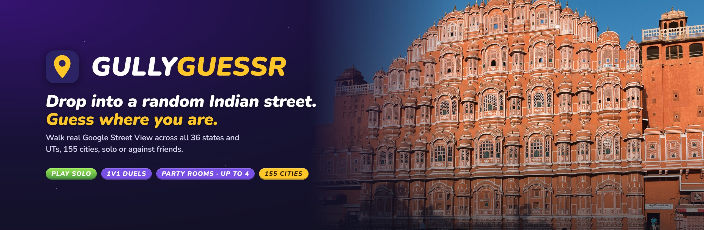
</p>

<p align="center">
  
  
  
  
  
  
</p>

### 🎮 [Play it live](https://gully-guessr-ojaa6wkhaa-el.a.run.app)

**Gully Guessr** drops you onto a random street somewhere in India. Walk around in Google Street View, read the shop boards and the number plates, then drop a pin on the map. The closer you are, the more you score.

Solo play needs no account: open the page and play, with personal bests, settings, and recent matches kept in `localStorage`. Log in to play multiplayer: random 1v1 matchmaking, private duels, and party rooms for up to four.

<p align="center">
  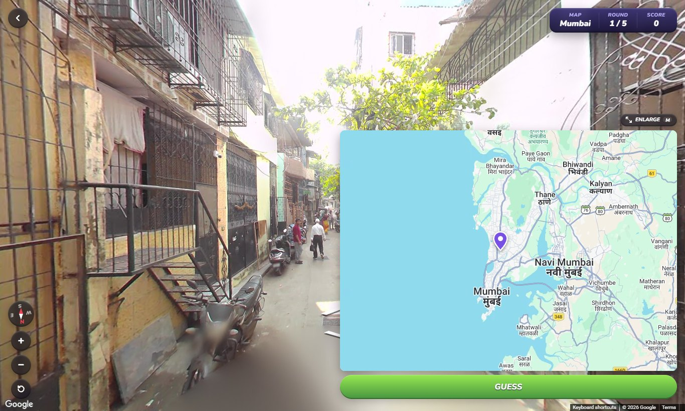
  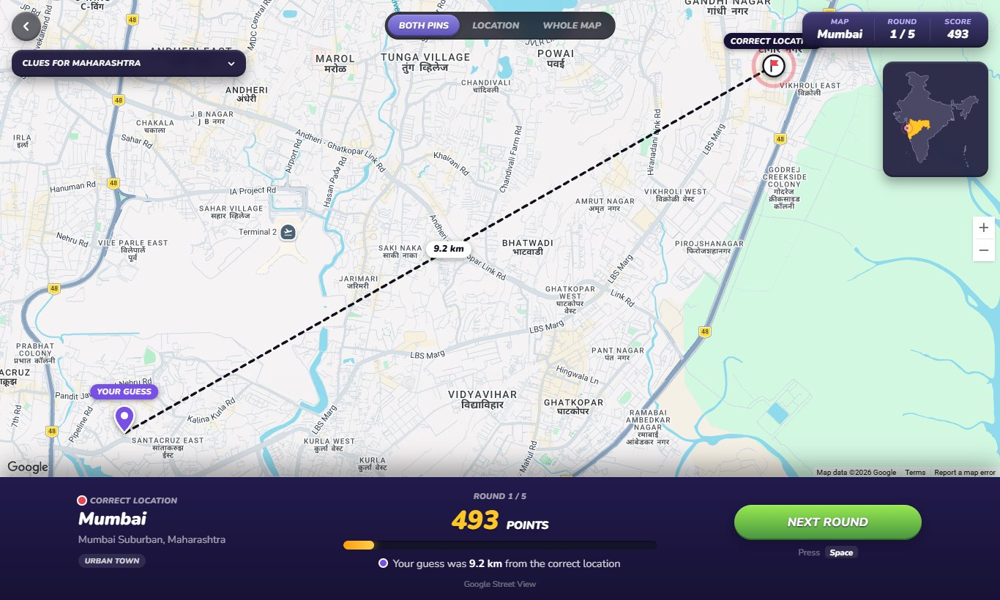
</p>

## Features

- **5-round matches across India** — procedurally sampled across all 28 States and 8 Union Territories with balanced population weighting so smaller and Himalayan/Northeast states appear regularly.
- **Country, state, and city maps** — play **All India** or a region pack (**North**, **South**, **West**, **East**, **Metro**), any single state, or one of 155 cities (searchable by city or state on the home page).
- **Accounts** — email + password sign-up with password reset, or Google sign-in (Firebase Auth).
- **Multiplayer** — **Quick match** pairs the next two players who are looking; **Duel a friend** and **Party room** (2–4 players) use a 5-letter room code or invite link. Everyone plays the same five streets; once the first player guesses, the rest have 15 seconds.
- **Multiple rulesets & timers** — Standard, No Move, and NMPZ (`No Move, Pan, Zoom`), untimed or `60s` / `90s` / `120s` per round.
- **Zero-key Open Mode by default** — works out of the box using Wikimedia Commons street photography and a verified local pool of 47 images, with optional upgrades to **Mapillary 360°** or **Google Street View**.
- **Regional clues on reveal** — inspect distance off, score, reverse-geocoded locality, and state/UT clues (scripts, RTO plate prefixes, landscape tells, and visual hints).

## Screenshots

| Pick a map | Multiplayer |
| --- | --- |
| 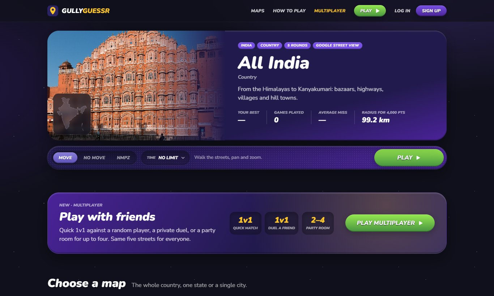 | 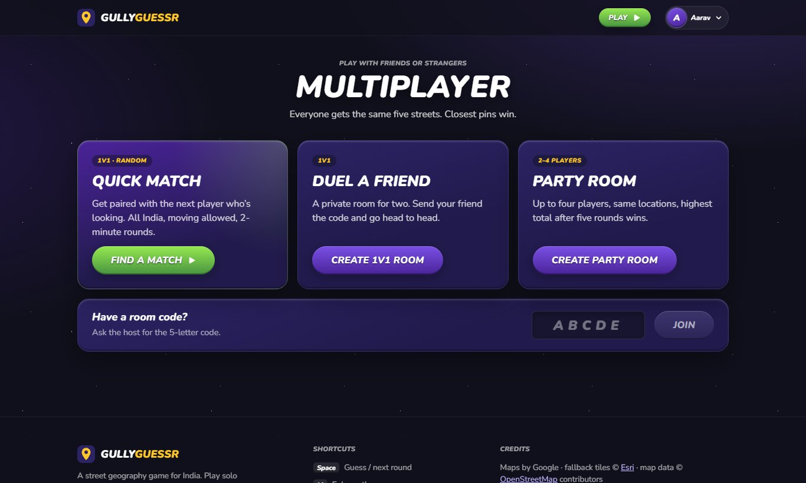 |
| **Party room lobby** | **"Hurry up!" — 15 seconds after the first guess** |
| 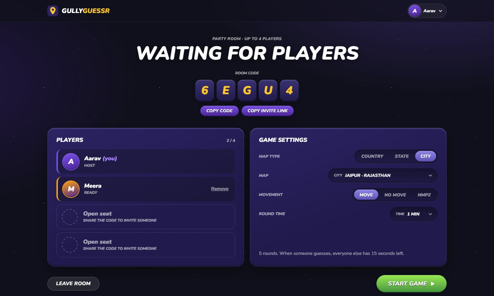 | 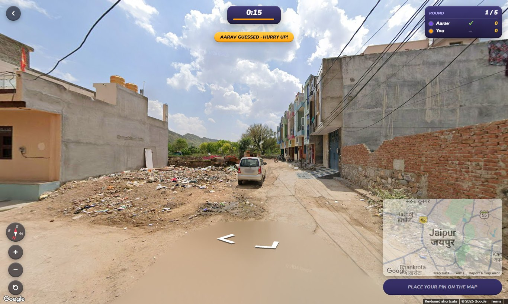 |
| **Everyone's pins on the reveal** | **Final results** |
| 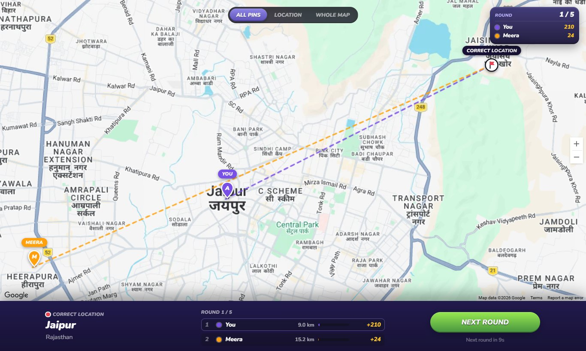 | 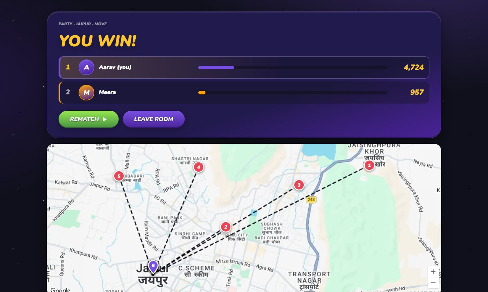 |

<p align="center">
  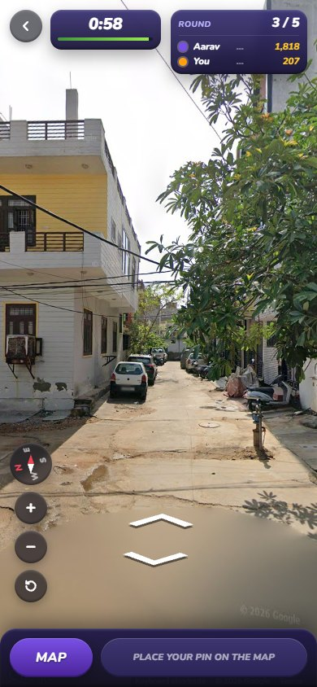
  &nbsp;&nbsp;
  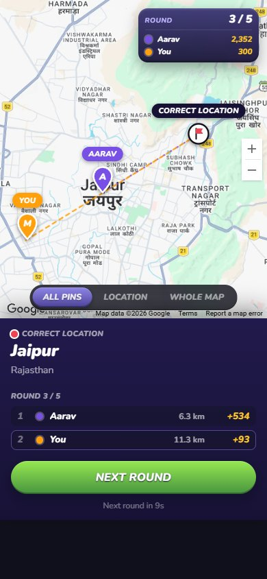
</p>

## Quick start

```bash
npm install
npm run dev        # http://localhost:5173 — the multiplayer game server runs inside the dev server on /ws
```

For production, `npm run build` then `npm start` serves `dist/` and the game server from one Node process (port `PORT`, default `8080`). The host must support WebSockets; static-only hosting (Vercel, Netlify, GitHub Pages) gives you single-player only.

## Deploy (Google Cloud Run, free tier)

The included [`Dockerfile`](Dockerfile) packages the site and the game server into one container. Cloud Run supports WebSockets, scales to zero when nobody is playing, and its free tier covers a small game.

```bash
gcloud auth login
gcloud services enable run.googleapis.com cloudbuild.googleapis.com artifactregistry.googleapis.com --project <project>
node scripts/deploy-cloudrun.mjs --project <project> --region asia-south1
```

The script reads the `VITE_*` values from your `.env`, builds the image in Cloud Build, and deploys with `--max-instances=1` (rooms live in memory, so every player must reach the same instance; this also caps your bill). After the first deploy:

1. Add the service's `*.run.app` host under Firebase **Authentication → Settings → Authorized domains**, or logins fail on the live site.
2. Add `https://<your-service-url>/*` to the allowed HTTP referrers on your Google Maps API key.

WebSockets on Cloud Run last at most an hour; clients reconnect and rejoin their room automatically.

## Accounts & multiplayer

1. Create a Firebase project (or add Firebase to an existing Google Cloud project), add a **Web app**, and copy its config into the `VITE_FIREBASE_*` keys in `.env`.
2. In **Authentication → Sign-in method**, enable **Email/Password** and, optionally, **Google**. Add your production domain under **Settings → Authorized domains**.

The game server (`server/`) verifies Firebase ID tokens against Google's public keys, so it needs no service account. It is authoritative: it holds the rooms, the clock, and the scores. One player's browser (the host, or whoever takes over if they drop) finds each round's Street View spot with the same generator as solo play and sends it up. Players who disconnect mid-match can rejoin; leaving a 1v1 gives the opponent the win.

Rooms live in memory, so restarting the server ends running matches. Each browser receives the round's coordinates to show Street View, so a determined player can cheat; play with people you trust.

To rename the title in one place, edit `GAME_TITLE` in [`src/config.ts`](src/config.ts) (and `<title>` in [`index.html`](index.html)).

## Imagery providers

| Tier | Enable with | What you get |
| --- | --- | --- |
| 1 · Google Street View | `VITE_GOOGLE_MAPS_API_KEY` | Live outdoor Street View — click arrows / the road (or use arrow keys) to walk the streets |
| 2 · Mapillary 360° | `VITE_MAPILLARY_ACCESS_TOKEN` | Free crowd-sourced street-level imagery in MapillaryJS with spatial and sequence navigation |
| 3 · Open Mode (default) | *(none required)* | Still Wikimedia Commons street photographs (no navigation), plus a verified local pool of 47 images |

Copy [`.env.example`](.env.example) to `.env` and fill in a key to upgrade, then restart `npm run dev`. Providers degrade gracefully (`Google → Mapillary → Open`), and a round only falls back to a still photo if no navigable imagery is found after 14 candidates.

### Spoiler-proofing

During a round the street viewers hide everything that names the place: road labels on the navigation arrows, the address card, the capture date, and Mapillary's attribution bar. The Google logo stays visible but its link is disabled, and the "Report a problem" link is removed, because both open Google Maps at the exact coordinates. Photographer and licence credits appear on the reveal screen instead. Signs that are physically in the imagery (shop boards, milestones) stay visible — reading them is part of the game.

## How a round is generated

1. **Archetype roll** (`src/engine/locationGenerator.ts`): urban town 45% · highway corridor 28.5% · rural settlement 18% · coast/hills/heritage 7% · forest road 1.5%.
2. **Balanced state pick**: square-root-dampened population weights with a floor, so the Northeast, Himalaya, and small states appear regularly. Region packs filter the anchor atlas first.
3. **Jitter + boundary guard**: uniform polar jitter (`r = R·√u`) around one of ~470 anchors (`src/data/indiaAnchors.ts`), validated against a simplified India-POV Natural Earth landmass (`src/data/indiaBoundary.ts`). Rounds in a game stay ≥ 35 km apart; recently used anchors are avoided across sessions.
4. **Snap & verify** (`src/engine/roundPlanner.ts`): up to 14 candidates with a street-view provider (8 in Open Mode) in concurrent batches of 2. The provider snaps them to imagery; `identifiabilityFilter.ts` rejects forest-only spots via Overpass (1.5 s timeout, circuit breaker, graceful fallback) and dark/blank images. The next round is prefetched while you play.
5. **Reveal**: reverse geocoding (Google or Nominatim at ≤ 1 req/s, falling back to anchor metadata) plus per-state clues (`src/data/indiaStateClues.ts`: scripts, RTO prefix, landscape, and look-for hints for all 28 States + 8 UTs).

## Scoring

Scores scale with the size of the map (`size` = diagonal of the play area in km): `round(5000 · e^(−10 · d / size))` for a haversine miss of `d` km, and full marks within `0.025%` of the size (25 m minimum). Missing by a tenth of the map leaves about 1,840 points, whether that's 445 km across India or 3.7 km in Bengaluru. Five rounds per game, `25,000` max score. Multiplayer scores are computed on the server with the same formula.

## Keyboard shortcuts

| Key | Action |
| --- | --- |
| `Space` | Lock in guess / next round |
| `Enter` | Next round |
| `M` | Expand or collapse map |
| `Esc` | Collapse expanded map |
| `R` | Back to the starting spot |
| `↑` / `↓` | Walk along the road (Standard ruleset, street-view providers) |
| `+` / `−` | Zoom view |

## Scripts

```bash
npm test           # Vitest: scoring, generator, boundaries, cities, and the multiplayer lobby/match logic
npm run build      # Type-check + production build
npm start          # Production server: dist/ + multiplayer WebSocket on /ws
npm run preview    # Preview production build locally (no multiplayer)
npm run typecheck  # TypeScript check
```

## Tech stack

- React 19 + TypeScript + Vite
- Google Maps JavaScript API for Street View and the guess/reveal maps (Leaflet fallback)
- Firebase Auth for accounts; a Node `ws` game server with `jose` token verification
- Leaflet & `react-leaflet` for the guess & reveal maps when no Google key is set
- `mapillary-js` for navigable Mapillary street view
- `@photo-sphere-viewer/core` & Three.js for static 360° Commons panoramas
- Vitest for unit & Monte Carlo distribution tests

## Attribution

Map tiles © Esri; map data © OpenStreetMap contributors; geocoding by Nominatim; land checks via Overpass API; boundary from Natural Earth (public domain). Street photographs come from Wikimedia Commons and are credited on each reveal. Hero photo: “Jaipur – Hawa Mahal bazaar view” by Daniel Villafruela, CC BY-SA 3.0; the README banner and social preview (`docs/banner.jpg`, `public/og-image.jpg`) are adapted from it under the same licence. Screenshots show Google Street View and Google Maps imagery © Google.
